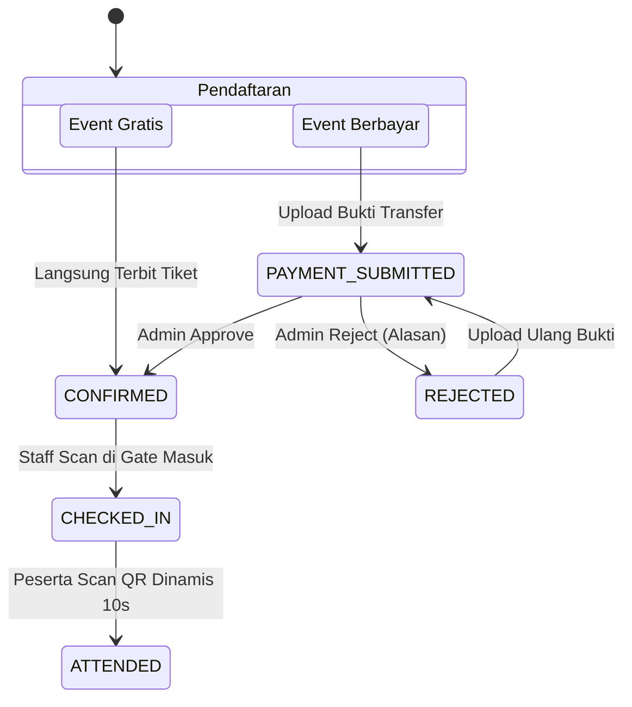

# Ticket Issuance, Email Delivery & Gate Check-In Skill

Skill ini mengatur siklus hidup tiket sejak pendaftaran (gratis maupun berbayar), proses verifikasi pembayaran, pengiriman tiket via email interaktif, hingga pemindaian di pintu masuk (gate check-in) oleh staf.

---

## 1. Siklus Hidup Tiket & Status Pendaftaran



---

## 2. Struktur Data Tiket & Generator

### 2.1 Identitas Tiket Unik
- `ticketCode`: String berformat `EVT-{YYYYMM}-{6-CHAR-ALPHANUM}` (misal: `EVT-202611-K9X2P4`).
- `magicToken`: UUID v4 acak kriptografis (`uuidv4()`). Token ini berfungsi sebagai kredensial aman bagi tamu (guest) untuk membuka tiket digital dan scanner absensi di HP tanpa perlu mendaftar akun.

### 2.2 Payload QR Code Tiket
QR Code yang tercantum pada tiket (email atau halaman web) memuat:
```text
https://domain.com/verify-ticket?code=EVT-202611-K9X2P4
```
Atau raw payload `ticketCode` yang langsung diproses oleh scanner gate staf.

---

## 3. Layanan Pengiriman Email (Nodemailer)

### 3.1 Spesifikasi Template HTML Interaktif
- **Embedded QR Code**: QR code digenerate sebagai Base64 data URL (`qrcode.toDataURL()`) atau di-attach sebagai CID (`Content-ID: 'ticket-qr'`) agar langsung tampil di semua email client (Gmail, Apple Mail, Outlook).
- **Detail Lengkap**:
  - Judul Event, Tanggal, Waktu Mulai/Selesai, Lokasi Fisik / Venue.
  - Nama Peserta, Email, Nomor Telepon, Nomor Tiket.
  - Status Pembayaran: Lunas & Terkonfirmasi.
- **Tombol Akses Tiket Digital**:
  Tautan langsung menuju halaman tiket:
  `[Buka Tiket Digital & Scanner Absensi](https://domain.com/tickets/{magicToken})`

---

## 4. Prosedur Scanner Gate Staf (`/staff/gate-scanner`)

Staf yang bertugas di pintu masuk menggunakan antarmuka pemindai gate:
1. **Continuous Camera Scanning**: Kamera aktif memindai QR code tiket peserta secara cepat.
2. **Audio/Haptic Feedback**:
   - Bunyi Beep Sukses + Getar HP saat tiket valid.
   - Bunyi Buzzer Peringatan jika tiket palsu atau sudah pernah check-in.
3. **Pencegahan Double Entry**:
   - Jika `checkInStatus === 'CHECKED_IN'`, tampilkan peringatan mencolok:
     *"⚠️ Tiket ini sudah di-scan sebelumnya pada pukul HH:MM oleh Staf [Nama]"*.
   - Mencegah tiket yang sama dibagikan dan dipakai berkali-kali.
4. **Pencarian Manual**:
   - Disediakan kolom input manual nomor tiket atau nama peserta jika layar HP peserta retak atau QR tidak terbaca kamera.
